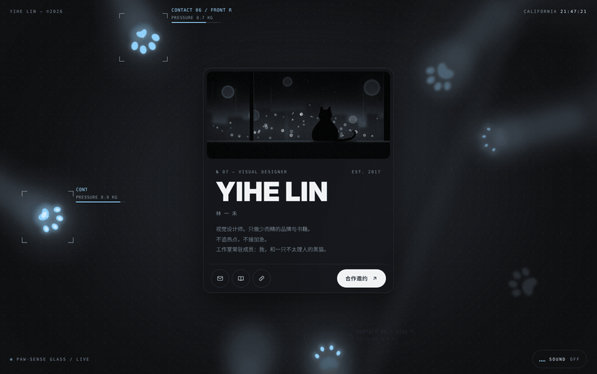
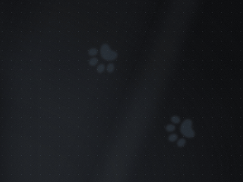

# cat-paw-glass

A concept for a personal profile page, seen from under a glass table. The glass is a touch-sensing surface: when a cat presses its paw on it, only the spots in real contact light up.



## What it does



- **The press**: the toe tips touch first and show as a few dim points of light. As the paw settles, the pads spread, the toes splay, the centres burn white and the glow bleeds into the frosted glass. On lift-off the main pad goes dark first and the toes leave last, leaving a slowly fading afterglow.
- **Depth of field**: only the pads touching the glass are sharp. The leg and body get blurrier the farther they are from the glass.
- **Kneading**: two front paws in the top right push in turn, and their glow pulses with each push.
- **Readouts**: every contact brings up a focus bracket, a contact label and a pressure bar.
- **Sound**: press `SOUND` in the bottom right. The music is synthesized live in the page with Web Audio (an ambient pad, sub bass and rain). Each paw that lands rings a glass tone, panned to where it lands on screen. No audio files are used.

<br clear="right">

## Run it

It's a plain static page with no build step. Open `index.html` in a browser, or serve the folder locally:

```bash
python3 -m http.server 8000
# then open http://localhost:8000
```

### Deploy to GitHub Pages

In the repo, go to Settings → Pages, set Source to `Deploy from a branch`, choose `main` and `/ (root)`, and save. The page is live a minute or two later.

### URL options

- `?accent=c8ff3d` changes the glow colour (6-digit hex, no `#`), e.g. acid green `c8ff3d` or signal red `ff453a`
- `?hud=0` hides the focus brackets and readouts

## Files

| Path | What it is |
| --- | --- |
| `index.html` | The whole page: styles, animation, paw generation and sound synthesis all live in this one file |
| `assets/night.jpg` | The photo on the card (drawn in code, not a real photo) |
| `docs/demo.gif`, `docs/kneading.gif` | The GIFs in this README |
| `tools/night.py` | Renders the card photo. Needs `numpy` and `Pillow`: `python3 tools/night.py` |
| `tools/make_gifs.sh`, `tools/capture.js` | Re-record the README GIFs: pause the page's animations, screenshot frame by frame, then crossfade the end into the start for a seamless loop. Needs Node + Playwright, Pillow and ffmpeg: `tools/make_gifs.sh` |

The GIFs were recorded on a machine that couldn't reach Google Fonts, so the name and the monospaced labels use local stand-in fonts. The live page loads Anton and IBM Plex Mono, so the lettering looks slightly different there.

## Notes

- The person on the page ("Yihe Lin"), the bio and the photo are fictional. This is a concept piece.
- The view-from-under-the-glass idea came from a personal website shared by 三眼鱼石 DESIGN on Xiaohongshu.
- The page respects the system's "reduce motion" setting: with it on, the animations stop.
