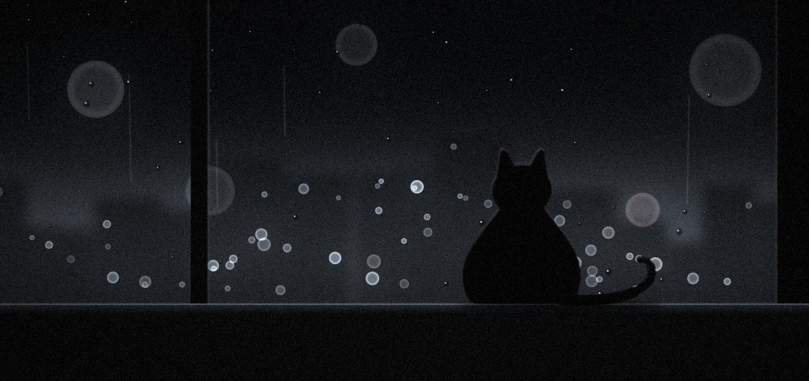

# cat-paw-glass

一个从「玻璃桌底下往上看」的个人主页概念稿：玻璃是一块触控感应屏，猫爪按上来，只有真正贴住玻璃的地方才会发出冷光。



## 效果

- **按压过程**：脚趾尖先碰到玻璃，亮起几个暗淡的小光点；压实后肉垫摊开、脚趾张开，中心亮到发白，光晕渗进磨砂玻璃；抬起时后掌先灭、脚趾最后离开，原地留一圈慢慢衰减的余辉。
- **景深**：只有贴着玻璃的肉垫是清楚的，腿和身体离玻璃越远越模糊。
- **踩奶**：右上角两只前爪交替收放，光一明一暗地跳。
- **标注**：每次接触会弹出对焦框、接触编号和一根压力条。
- **声音**：点右下角 `SOUND` 开启。背景音乐用 Web Audio 在页面里实时合成（氛围长音、超低音、雨声），每只爪子落下会响一声玻璃音，左右声道跟着爪子的位置走。不用任何音频文件。

## 运行

纯静态页面，没有构建步骤。直接用浏览器打开 `index.html`，或者起一个本地服务：

```bash
python3 -m http.server 8000
# 打开 http://localhost:8000
```

### 部署到 GitHub Pages

仓库 Settings → Pages → Source 选 `Deploy from a branch`，分支选 `main`、目录选 `/ (root)`，保存后等一两分钟即可访问。

### 可选参数

- `?accent=c8ff3d` 换冷光颜色（6 位十六进制，不带 `#`），比如酸性绿 `c8ff3d`、信号红 `ff453a`
- `?hud=0` 关掉对焦框和标注

## 文件

| 路径 | 说明 |
| --- | --- |
| `index.html` | 整个页面：样式、动画、爪印生成和声音合成都在这一个文件里 |
| `assets/night.jpg` | 卡片上的照片（用代码画的，不是真实照片） |
| `tools/night.py` | 生成上面那张图的脚本，需要 `numpy` 和 `Pillow`：`python3 tools/night.py` |

## 说明

- 页面上的人物「林一禾 / YIHE LIN」、简介和照片都是虚构的，仅作概念展示。
- 视角创意参考了小红书博主「三眼鱼石 DESIGN」分享的一个个人网站。
- 页面会尊重系统的「减少动态效果」设置，开启后动画会停下来。
